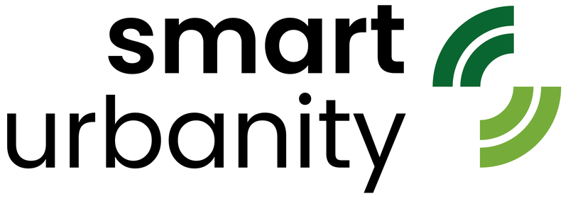
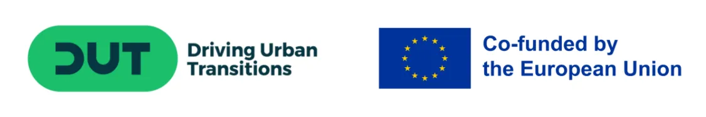

<div align="center">


<br><br>



### SmartUrbanity Public Materials

**Deliverables, publications, presentations, media and open data from the SmartUrbanity project**

[](https://www.smarturbanity.com)
[](https://www.linkedin.com/company/smarturbanity/)
[](https://github.com/smarturbanity)


</div>

---

## About this repository

This repository is the public archive of **SmartUrbanity: Advancing 15-Minute Cities through Collaborative and Smart Urban Solutions**, a 36-month research and innovation project under the **Driving Urban Transitions (DUT) Partnership**.

It contains only material that the consortium has approved for public release: public deliverables, scientific publications, presentations, the project media kit and anonymised open datasets. It contains no software. The source code and configuration of the SmartUrbanity tools are kept in separate repositories under the [smarturbanity](https://github.com/smarturbanity) organisation.

## About SmartUrbanity

SmartUrbanity aims to make the 15-minute city, where everyday services can be reached within a short walk, cycle or public transport trip, **measurable, inclusive and actionable**. Accessibility is shaped not only by distance and travel time but also by how a trip *feels*: safety, comfort, reliability, physical effort and personal circumstances. The project combines objective network analysis with citizen-reported experience and turns both into evidence that planners and decision-makers can use.

The toolkit includes **Access Together**, a citizen engagement mobile app; **Access Lab**, an accessibility analysis platform made up of the participatory **Access Hub** and the analytical **Access Atlas**; and a **Decision Support System** for comparing scenarios and prioritising interventions.

The tools are tested in five pilot areas: **Rome** (Municipio XII, Italy), **Karlsruhe** (Germany), **İzmir** (Türkiye), the **Lyon Metropolitan Area** (France) and the **Greater Zurich Area** (Canton of Thurgau, Switzerland). The consortium brings together **16 partners from 6 countries**, coordinated by **Sapienza University of Rome** and technically by **CTLup**.

More on the project: [www.smarturbanity.com](https://www.smarturbanity.com) and the [organisation profile](https://github.com/smarturbanity).

## Repository structure

```
smarturbanity-public/
├── deliverables/     Public project deliverables (PDF)
├── publications/     Peer-reviewed papers, conference papers and posters
├── presentations/    Slides from conferences, workshops and project events
├── media/            Logos, banners, photos and other communication material
│   ├── logos/
│   ├── banners/
│   └── photos/
└── open-data/        Anonymised, aggregated datasets with documentation
```

| Folder | Contents |
|---|---|
| [`deliverables/`](deliverables/) | Deliverables with dissemination level **Public**, in their final, approved version |
| [`publications/`](publications/) | Open-access versions of scientific outputs (author accepted manuscripts or published versions where permitted) |
| [`presentations/`](presentations/) | Slides and posters presented at conferences, stakeholder workshops and consortium events |
| [`media/`](media/) | Official SmartUrbanity logos, banners and event photos for press and partner communication |
| [`open-data/`](open-data/) | Anonymised and aggregated datasets released following FAIR principles, each with a README describing sources, methods and variables |

## Public deliverables

| No. | Title | Lead | Work package |
|---|---|---|---|
| D1.0 | Inception Report | CTLup | WP1 Project Management |
| D2.1 | Concept Knowledge Report | KIT | WP2 Research and Analysis |
| D2.2 | Framework Blueprint | HUN-REN SZTAKI | WP2 Research and Analysis |
| D2.3 | Model and Data Management System | ZHAW | WP2 Research and Analysis |
| D2.4 | User Insights and Design Recommendations | ENTPE | WP2 Research and Analysis |
| D6.1 | Dissemination Materials Package | ZHAW | WP6 Dissemination and Knowledge Sharing |

The files are in [`deliverables/`](deliverables/) and can also be downloaded from the [project website](https://www.smarturbanity.com/deliverables). Further public deliverables, including the app and platform prototypes, pilot reports, policy recommendations and roadmaps, will be added here once approved.

## Publications

- C. Muratori. *Exploring Demand-Responsive Transport Suitability in Rural Switzerland: A Simulation Approach for the Canton of Thurgau.* TRANSCODE 2025.

The full, up-to-date list is on the [publications page](https://www.smarturbanity.com/publications).

## File naming

To keep the archive easy to browse, files follow these conventions:

| Type | Pattern | Example |
|---|---|---|
| Deliverable | `D<WP>.<n>_<Short_Title>.pdf` | `D2.1_Concept_Knowledge_Report.pdf` |
| Publication | `<YYYY>_<FirstAuthor>_<Short_Title>.pdf` | `2025_Muratori_DRT_Thurgau.pdf` |
| Presentation | `<YYYY-MM-DD>_<Event>_<Short_Title>.pdf` | `2026-10-15_Izmir_Consortium_Meeting.pdf` |
| Dataset | `<pilot>_<topic>_<YYYY>/` with its own `README.md` | `rome_accessibility_survey_2026/` |

Presentations are shared as PDF. Large media files and datasets should be added with [Git LFS](https://git-lfs.com) or linked from an external repository such as Zenodo.

## Using these materials

- **Citation.** When you use or refer to these materials, please cite the original document and the SmartUrbanity project, for example: *SmartUrbanity consortium (2026). D2.1 Concept Knowledge Report. SmartUrbanity, Driving Urban Transitions Partnership.*
- **Logos.** The SmartUrbanity logo may be used to refer to the project. The DUT Partnership and European Union emblems are subject to their own usage rules and must not be altered.
- **Data protection.** Datasets in [`open-data/`](open-data/) contain only anonymised or aggregated information. Raw or personal data collected in the pilots is never published here, in line with **GDPR**, the Swiss **FADP** and Türkiye's **KVKK**.
- **Questions or reuse requests:** [smarturbanity@gmail.com](mailto:smarturbanity@gmail.com).

## Contributing (consortium partners)

Only materials approved for public release may be added. Before opening a pull request, please check that:

1. The document's dissemination level is **Public** and it is the final, approved version.
2. It contains no personal data, contact lists, internal budgets or confidential partner information.
3. The file follows the naming conventions above and is placed in the right folder.
4. Third-party content (images, maps, figures) is cleared for publication.

## Consortium

| Country | Partners |
|---|---|
| 🇮🇹 Italy | Sapienza University of Rome (Project Coordinator) · CTLup (Technical Coordinator) · Movesion · Municipio XII of Rome · Rome Citizens' Consultation for Road Safety, Active Mobility and Sustainability |
| 🇩🇪 Germany | Karlsruhe Institute of Technology (KIT) · City of Karlsruhe · Karlsruher Verkehrsverbund (KVV) |
| 🇹🇷 Türkiye | Ege University · İzmir Metropolitan Municipality |
| 🇫🇷 France | ENTPE · Métropole de Lyon · Arts et Métiers (ENSAM) |
| 🇨🇭 Switzerland | ZHAW Zurich University of Applied Sciences · PostAuto AG |
| 🇭🇺 Hungary | HUN-REN SZTAKI |

## Contact

- **Email:** [smarturbanity@gmail.com](mailto:smarturbanity@gmail.com)
- **Website:** [www.smarturbanity.com](https://www.smarturbanity.com)
- **LinkedIn:** [SmartUrbanity](https://www.linkedin.com/company/smarturbanity/)

## Acknowledgement

This project has been funded by **MIMIT** (Italy), **NKFIH** (Hungary), **BMFTR** (Germany), **TÜBİTAK** (Türkiye), **Innosuisse** (Switzerland) and **ANR** (France), under the **Driving Urban Transitions Partnership**, which has been co-funded by the European Commission.

The content of these materials reflects only the authors' views. The funding agencies and the European Commission are not responsible for any use that may be made of the information they contain.

<div align="center">



</div>
